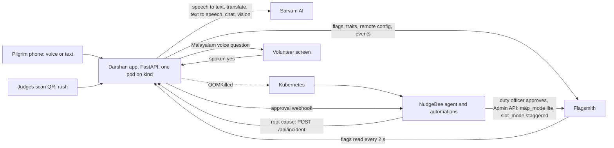

# Darshan Rush

[](REPO_URL/actions/workflows/tests.yml)

**A prototype that lets a pilgrim book a darshan slot by speaking in her own language, and keeps working when the whole crowd arrives at once.**

- **Watch the 2-minute film:** https://drive.google.com/file/d/1Q1--7aCu7ZJrTQjNaBVR0S58QlCgF01J/view
- **Try it (no login, simulated crowd):** https://sacrifice-brain-troubleshooting-conference.trycloudflare.com (temporary demo link: it runs from one laptop and may be offline) (open on a phone; tap the big button and talk)

> Simulated crowd. Not affiliated with any temple. Not for operational use.

## Links

All open without a login; the live ones run from one laptop through a temporary tunnel and may go offline after the event):
- Start here (choose pilgrim, temple staff or judge): https://sacrifice-brain-troubleshooting-conference.trycloudflare.com/start
- Pilgrim screen (tap once and talk; the map is on the same screen): https://sacrifice-brain-troubleshooting-conference.trycloudflare.com/
- Temple staff screen (the rush question, book for a pilgrim, report crowd, ask anything, requests near you): https://sacrifice-brain-troubleshooting-conference.trycloudflare.com/volunteer
- For temples (what a shrine gets and what it costs): https://sacrifice-brain-troubleshooting-conference.trycloudflare.com/for-temples
- Sponsors page (Sarvam, Flagsmith and NudgeBee shown live): https://sacrifice-brain-troubleshooting-conference.trycloudflare.com/sponsors
- Presenter page (QR code, the chain of steps, cause the rush): https://sacrifice-brain-troubleshooting-conference.trycloudflare.com/judge
- Recovery graph: https://sacrifice-brain-troubleshooting-conference.trycloudflare.com/graph
- Demo video: https://drive.google.com/file/d/1Q1--7aCu7ZJrTQjNaBVR0S58QlCgF01J/view
- Repository: https://github.com/ArunSiddardha/darshan-rush
- Proof of one real end-to-end run (crash lines, NudgeBee approval, Flagsmith before and after): https://github.com/ArunSiddardha/darshan-rush/tree/main/metrics/proof
- How each sponsor is used, with file paths: https://github.com/ArunSiddardha/darshan-rush#readme

## Judge this in 90 seconds

1. Open https://sacrifice-brain-troubleshooting-conference.trycloudflare.com on a phone, tap once, say "I need a slot for tomorrow morning" in Telugu, Tamil, Malayalam, Kannada, Hindi or English. The language is detected from your speech (Sarvam). No form, no language picker.
2. Open `/judge`. Press "Cause the rush". The booking pod on Kubernetes slows, then is OOMKilled (a real kernel kill of a 160Mi pod, made reproducible on purpose, see [LIVE_VS_SIMULATED](LIVE_VS_SIMULATED.md)).
3. Open `/volunteer`. NudgeBee's root cause appears, and the app asks the volunteer by voice in Malayalam. A spoken yes (two deliberate presses of Yes if you do not speak Malayalam) starts the NudgeBee approval workflow.
4. After approval, two Flagsmith flags flip (`map_mode` full to lite, `slot_mode` open to staggered), with no redeploy, and `/graph` shows the recovery. In the run shown in the film: slowest requests about 3 s and the pod OOMKilled 36 s into the rush; after NudgeBee flipped the flags the same rush ran at about 1,000 requests a second with 0 errors, p95 14 ms and zero restarts ([numbers](#how-the-rush-incident-works-step-by-step)).
5. Open `/sponsors`. It shows what Sarvam, Flagsmith and NudgeBee actually did in this running app, and says "not available" where the app cannot see it.

## The story

Lakshmamma is 68, speaks only Telugu and has never booked anything online. On 8 January 2025 six people died in a crush for darshan tokens at Tirupati (as reported in the press), and in November 2025 the Kerala High Court noted that over a lakh people climbed Sabarimala on a day when 80,000 were allowed. Darshan Rush lets her tap once and talk, hears her slot read back in Telugu, and shows a simple simulated map with waits per stop, while a volunteer at the spot counter books for walk-ins who have no phone. It holds under a rush because the heavy live map is a flag, not a rewrite: when the pod chokes, NudgeBee finds the cause, a volunteer approves by voice, and Flagsmith switches to a light map and staggered slots in seconds, so every pilgrim still gets a slot.

## What a pilgrim can do

- Book a slot by voice: live hands-free conversation (default) or tap to talk; typing works if voice is down.
- Hear the slot read back in the detected language, and hear it again with one tap.
- Ask where she is and how long the wait is at each of five simulated stops ("I reached River Crossing", "what is the wait at Forest Path"), and see them on a simple map.
- Ask facility and venue questions (water, toilets, medical post, wheelchair help, what to carry), answered from a swappable knowledge pack.
- Say a complaint or a need for help (lost child, unwell); it becomes a tracked care request that goes to the nearest simulated on-duty volunteer.
- "Read this for me": photograph a ticket or sign, get it read, translated and spoken.
- "Is this booking site real?": a calm warning for a pasted link or an offer. It never says a site is genuine.
- Elders (traits from Flagsmith) get a larger voice-first layout.

## What temple staff can do

- Walk-in booking: the volunteer speaks for a pilgrim without a phone, and the slot is read back in the pilgrim's language.
- Answer the NudgeBee question by voice (Malayalam or English): a yes starts the approval workflow, a no changes nothing.
- Report the crowd by voice, and use "Ask anything" (live waits, bookings, open help requests) by voice or text.
- See and act on care requests: acknowledge, on the way, resolved, could not resolve.
- Watch the incident chain on `/judge` and the sponsors page `/sponsors`.

## Sponsors: what each tool really does here

### Sarvam AI

| Use | What it does here | Where in the code | Proof | Our honest feedback |
|---|---|---|---|---|
| Speech to text with language detection | Pilgrim speech becomes text; the language is detected (model `saaras:v4`, mode `transcribe` for detection, `codemix` when the language is known) | `app/sarvam.py` (`stt`), `app/addons_live.py`, `app/directions.py`, `app/volunteer.py` | Real calls checked 25 Nov 2026 (`docs/notes/NOTES_BRAIN.md`, `docs/notes/NOTES_ADDONS.md`); `/sponsors` lists the recorded calls with ms and key slot; tests use mocks | `codemix` wrote romanised Hindi, so detection needs `transcribe`. A one-word reply such as "yes" is often empty or garbled, so we added big Yes/No buttons. |
| Translation | Text into the pilgrim's language, used by "Read this for me" and the site check | `app/sarvam.py` (`translate`), `app/addons_read.py` | `docs/notes/NOTES_SARVAM.md`: Malayalam, Telugu, Hindi verified | About 1.5 s per call. Wording not reviewed by a native speaker. |
| Text to speech | Slot readback, volunteer question, assistant replies (`bulbul:v3`, speaker `shubh`) | `app/sarvam.py` (`tts`), `app/volunteer.py`, `app/directions.py`; fixed lines cached on disk and shipped in `app/voice_seed` | Real calls checked; `/sponsors` "Last said" | 2 to 4.5 s per call, the slowest part of a turn, so we cache fixed lines. |
| Chat model behind the assistant | `sarvam-105b`, asked only for text the rules cannot classify, with a facts block; its JSON is validated (stop ids must exist, numbers must come from the facts) | `app/sarvam.py` (`chat`, `chat_json`), `app/assistant.py`, `app/addons_staff.py`, `app/addons_care.py`, `app/addons_scam.py` | `docs/notes/NOTES_BRAIN.md`, `docs/notes/NOTES_KB.md`: about 27 real calls with correct Telugu and Malayalam answers; model path is off when flag `assistant_llm` is `off` | It returned an EMPTY reply until we sent `reasoning_effort: null`, because hidden reasoning used the whole token budget. Answers can be thin, so the code validates and falls back to rules. |
| Language detection | Part of speech to text (above); the page and reply follow the detected language, including mid-conversation switches | `app/addons_live.py`, `app/directions.py`, `app/static/app.js` | Verified with recorded speech through the real recorder path; iPhone Safari not tested | Short utterances detect worst. |
| Photo reading | Sarvam Vision document intelligence (async job: parse, poll, results), then translate and speak | `app/addons_read.py` | Works on clean sample images (`app/static/samples/`), 5 to 6 s end to end (`docs/notes/NOTES_SARVAM.md`) | The language hint matters: with `en-IN` it invented Malayalam, so we default the hint to `hi`. Not tested on glary or distant real photos. |
| Resilience | Two keys; on HTTP 402 or 429 the app moves to the other key; on no credits it says "Voice unavailable (Sarvam credits). Type instead." | `app/sarvam_keys.py`, `app/sarvam.py` | `app/tests/test_addons_sarvam.py` (mocks); key rotation not triggered live | No streaming: batch calls only. |

### Flagsmith

All flags live in project 55985. Read live on 25 Nov 2026 from the edge API for this document.

| Flag or segment | What it controls | Who flips it |
|---|---|---|
| `map_mode` (`full` or `lite`) | Full mode builds the heavy live map render on every request (what OOMs the pod under a rush); lite skips it and answers one short sentence per reply | NudgeBee workflow HTTP task after approval (`scripts/flip.sh` is the manual fallback) |
| `slot_mode` (`open` or `staggered`) | Open: first free window. Staggered: spreads bookings across the next windows | Same NudgeBee workflow |
| `voice_directions` (`voice` or `map`) | The A/B test. Metric `reached_gate` (the "I reached the gate" tap). Per-visitor identity, with a local hash fallback | Experiment config in Flagsmith |
| `voice_first` (boolean) | Opens the large voice-first layout. Override ON for segment `elders_65_plus` (trait `age_65_plus` = true, set when the pilgrim says "my mother is 70") | Segment rule, no one flips it by hand |
| Segments `lang_ml`, `lang_ta`, `lang_te`, `lang_kn`, `lang_hi` (trait `language`) | Created by `scripts/flagsmith_setup.py`; no flag has a language override yet (the app picks copy by language itself) | Not used for decisions today |
| `ui_copy` (JSON remote config) | Banner per language, example phrases, `slot_cap` (30), `slot_window_min` (15). Read by `app/addons_flags.py` and `app/slots.py`, so copy and caps change without a deploy | Product owner in the Flagsmith dashboard |
| `voice_agent_v2` (boolean, percentage-split segment `rollout_voice_agent_v2`) | Staged rollout 10, 50, 100 percent. `scripts/rollout.sh` watches `/api/metrics-lite`; above 2 percent errors it pauses and rolls back one step. Currently 0 percent | An engineer running `scripts/rollout.sh` |
| `assistant_llm` (`on` or `off`) | `off` stops model calls so the assistant answers from rules and the knowledge pack | Intended: a NudgeBee workflow when the health guard fires (see NudgeBee, automation 4) |
| `venue_pack` | Which knowledge pack (`app/knowledge/<name>.json`) the assistant and map use | Operator |
| `reply_style` (`normal` or `brief`) | `brief` (also forced by lite map mode) gives one short sentence per reply | Operator |

Code: `app/flags.py` (server SDK, identities, traits, 2 s cache, last-good value, default handler, `request_timeout_seconds=3`), `app/addons_flags.py` (decisions, ui-copy, rollout), `scripts/flagsmith_setup.py` (idempotent setup), `scripts/rollout.sh`, `scripts/flip.sh`, `app/static/judge.html` ("Flagsmith decides", A/B card). The cake-shop flags `show_demo_button`, `lite_mode`, `rush_message` and `ordering_mode` still exist in the project from the earlier app and are unused.

Proof: `docs/notes/NOTES_FLAGS.md` (setup run against the real project, segment check through the edge API, 26 of 60 test identities on at a 50 percent split, healthy and breach rollout runs in `metrics/rollout.log`), and `/sponsors` for live values and last change times.

Our honest feedback: Flagsmith's own Experimentation results are not available on our plan (the identity call says "Events must be enabled to use experiment flags"), so `GET /api/experiment` keeps our own exposed and reached counts, labelled test traffic, and we still send the `reached_gate` event name. A percentage-split segment rule rejects a blank property and hashes any property you set (we create it with `x` then patch it to null). The v2 versioning API needs a non-null `feature_state_value` even for boolean overrides. The audit log is empty for changes made with an Admin API key, so we cannot tell a NudgeBee flip from a script flip (the sponsors page says it is correlation, not a signature).

### NudgeBee

| Part | What it does | Where | Proof |
|---|---|---|---|
| Agent on the cluster | Watches the kind cluster `nb` (namespace `darshan`), sees the OOMKilled event | `scripts/nudgebee_agent.sh`, `nudgebee/README.md` | [metrics/proof](metrics/proof/README.md) (see below) |
| Automation 1: `darshan-rush-investigate` | Trigger: event `event.created`, namespace `darshan`, type OOMKilled or CrashLoopBackOff. Tasks: `llm.event_investigate` (root cause), then `integrations.http` POST to `{PUBLIC_URL}/api/incident` with header `X-Incident-Token`, body `summary` and `rca` | `nudgebee/darshan-rush-investigate.yaml`, receiver `POST /api/incident` in `app/volunteer.py` (tolerant of broken JSON from an LLM summary) | Receiver tested with synthetic bodies (`app/tests/test_pass2.py`) |
| Automation 2: `darshan-staggered-approved` | Trigger: Automation Webhook, called by the app when the volunteer says yes (`event_id`, `approved_by`, `transcript`). Tasks: `core.approval` (in-app; a duty officer clicks Approve), then two `integrations.http` POSTs to the Flagsmith Admin API: `flip_map_mode` to `lite`, `flip_slot_mode` to `staggered` | `nudgebee/darshan-staggered-approved.yaml`, caller `post_webhook` in `app/volunteer.py` | The Flagsmith request is verified with curl (`scripts/flip.sh` makes the same two requests) |
| Automation 3: crash report | The app itself reports a crash. If a rush marker on `/data` is still set at the next start, the process was killed; it POSTs once to `NUDGEBEE_CRASH_WEBHOOK` (namespace, pod, reason, restarts seen, map mode) | `app/crash.py`; NudgeBee automation name: NUDGEBEE_AUTOMATION_3_NAME (workflow file not in the repo) | Tested with a mocked webhook; live cluster showed the restart and the timeline step |
| Automation 4: assistant health guard | If 5 model calls fail or take over 8 s within a minute, the app POSTs once (10 minute cool-down) to `NUDGEBEE_ASSISTANT_WEBHOOK`. The intended fix is to flip `assistant_llm` to `off`. `POST /api/assistant/simulate-failure` triggers it without spending Sarvam credits | `app/addons_state.py`; NudgeBee automation name: NUDGEBEE_AUTOMATION_4_NAME (workflow file not in the repo) | Guard logic tested; delivery to NudgeBee unverified |

The approval is the human gate: the volunteer's spoken yes is recorded as the audit note, and a duty officer clicks Approve in NudgeBee. The Flagsmith flip is the second half of the same workflow.

Proof of one unbroken real run (25 Nov 2026, 15:18 IST): [`metrics/proof/`](metrics/proof/README.md) has the real `kubectl` lines with the OOMKilled restart, NudgeBee's summary as it reached the volunteer screen, screenshots of the NudgeBee approval before and after, and the Flagsmith dashboard before and after NudgeBee changed the flags. Three of the four automations ran end to end on NudgeBee cloud today (`darshan-crash-report`, `darshan-rush-investigate`, `darshan-staggered-approved`); the fourth (`darshan-assistant-degraded`) is built and active and its trigger was received, but we did not approve a run. The workflow files in `nudgebee/` describe what was built in the NudgeBee console with its plain-English generator; their import format is not verified. In the recorded run the volunteer's yes was typed, not spoken.

Our honest feedback (from building it): the automation webhook URL only appears once the webhook is linked to a workflow; the root-cause text from the LLM summary can arrive as slightly broken JSON, so our receiver parses tolerantly; and the agent's own pods are not visible from our pod, so the sponsors page shows only what the app received.

## Live versus simulated

| | Real | Simulated | Planned (not built) |
|---|---|---|---|
| Crowd, waits, slots | The slot logic, caps and persistence | All crowd sizes, waits per stop, the pilgrim route, volunteers in the roster, the knowledge pack's times and distances | Real queue and gate feeds |
| Rush | The OOMKill (kernel), the restart, the metrics | The pilgrims: a load generator inside the pod; the memory hunger is deliberate (`HEAVY_MB`) | A load generator outside the cluster |
| Voice | Sarvam speech to text, text to speech, chat, translation, vision | Nothing | Streaming speech, a phone line for pilgrims without a smartphone (a labelled placeholder card only) |
| Flags | Flagsmith reads, traits, the flip, remote config, rollout | A/B traffic (test traffic); the rollout "breach" demo (`--breach-at`) | Flagsmith experiment results (not on our plan) |
| NudgeBee | Agent on the cluster, root cause, approval, the flip (see proof status above) | Nothing is mocked in the live path | Recorded proof for every automation |
| Site | Pages, APIs, tests | Everything labelled `SIMULATED` | A real temple integration. None exists. |

Full detail: [docs/LIVE_VS_SIMULATED.md](LIVE_VS_SIMULATED.md).

## Architecture



1. One FastAPI process (`app/main.py`) serves the pages (`/`, `/volunteer`, `/judge`, `/graph`, `/sponsors`) and the API, and mounts eight add-on routers.
2. Every Sarvam call goes through one client (`app/sarvam.py`) with an 8 s timeout, a two-key pool and no fake results.
3. Flag reads are cached for 2 s with a last-good value, so a Flagsmith outage keeps the last mode instead of failing.
4. State (bookings, volunteer state, care requests, speech cache) is JSON on `/data`, which survives a container restart but is an `emptyDir` (see the limits).
5. Detail and the module map: [docs/ARCHITECTURE.md](ARCHITECTURE.md).

## How the rush incident works, step by step

1. A rush starts (`POST /api/rush/start` with a token, from `/judge`): 16 simulated pilgrims ramp in, one every 3 s, each reading `/api/queue` and booking a slot.
2. In `full` map mode each request allocates 12 MB and holds it for 1.5 s (growing 15 percent per concurrent render), so latency climbs first, then the pod (224Mi limit; 160Mi in the first rehearsal) is OOMKilled, 19 to 36 s after the start across our runs. The full render only runs for rush traffic, so a few ordinary visitors cannot crash it.
3. The next process start finds the rush marker still set, counts a restart and reports the crash to NudgeBee once. The rush stays stopped.
4. NudgeBee investigates the event and posts the root cause to `/api/incident`. `/volunteer` shows the English summary and asks the question in Malayalam, spoken with Sarvam.
5. The volunteer says yes. The app classifies the reply (rules first, in six languages; unclear never approves) and calls the NudgeBee approval webhook.
6. A duty officer clicks Approve in NudgeBee. Two HTTP tasks flip `map_mode` to `lite` and `slot_mode` to `staggered` in Flagsmith.
7. The app re-reads flags within 2 s, the volunteer page shows "Booking recovered", and `/graph` shows the drop.

Measured on a local kind cluster with a 160Mi pod and an in-pod load generator (`metrics/rehearsal1.md`, 25 Nov 2026 14:07, `HEAVY_MB=12`, `HEAVY_HOLD_S=1.5`):

| | Before: full map, open slots | After: lite map, staggered slots |
|---|---|---|
| Duration observed | 19 s (stopped at first restart) | 71 s |
| Load requests completed (queue plus book pairs) | 5 | 37,587 |
| Failed requests | 0 (the pod died, so in-flight work was lost) | 0 |
| p95 latency, worst | 3081 ms | 15 ms |
| Requests per second, peak | 2.3 | 1107.4 |
| Pod restarts (OOMKilled) | 1 | 0 |

801 pilgrims were booked after the run, and they survived the restart. These numbers show graceful degradation on one laptop cluster. They are not a capacity claim: the load generator runs inside the pod and the "before" sample is tiny. Raw per-second data: `metrics/recovery.csv`.

## Setup (ten commands)

Needs Docker or colima, Python 3.12 and macOS or Linux. The scripts currently hard-code the repo path in `scripts/_common.sh` (`REPO=...`); change that one line for your machine.

```bash
brew install kind kubectl helm cloudflared                                # 1
cp .env.example .env                                                      # 2  fill in the values (names below)
python3 -m venv .venv && .venv/bin/pip install -r app/requirements.txt    # 3
scripts/cluster_up.sh                                                     # 4  kind cluster "nb", host port 8088
scripts/build_load.sh && scripts/secrets.sh                               # 5  image, then the secret from .env
scripts/deploy.sh                                                         # 6  app at http://localhost:8088
scripts/tunnel.sh                                                         # 7  public URL into metrics/public_url.txt; run deploy.sh again
python3 scripts/flagsmith_setup.py                                        # 8  segments and flags (needs FLAGSMITH_ADMIN_KEY)
scripts/nudgebee_agent.sh <agent-key>                                     # 9  then build the workflows from nudgebee/README.md
open http://localhost:8088/judge                                          # 10 QR and "Cause the rush"
```

To run the app without a cluster: `cd app && ../.venv/bin/python -m uvicorn main:app --port 8080`. Without `FLAGSMITH_ENV_KEY` it uses a local in-memory flag store and prints a warning (that is not Flagsmith).

| Variable | Purpose |
|---|---|
| `SARVAM_API_KEY`, `SARVAM_API_KEY_2` | Sarvam; the second key is used after 402 or 429 |
| `SARVAM_STT_MODEL`, `SARVAM_TTS_MODEL`, `SARVAM_TTS_SPEAKER`, `SARVAM_CHAT_MODEL` | Optional model overrides |
| `FLAGSMITH_ENV_KEY` | Server-side environment key (flags, identities, events) |
| `FLAGSMITH_CLIENT_KEY` | Optional client key for decisions and ui-copy (falls back to the env key) |
| `FLAGSMITH_ADMIN_KEY` | Setup script, rollout script, and the NudgeBee flip task. Not needed in the pod |
| `FLAGSMITH_API_URL` | Flagsmith edge API address |
| `NUDGEBEE_APPROVE_WEBHOOK` | Approval workflow URL, called after the volunteer says yes |
| `NUDGEBEE_CRASH_WEBHOOK` | Optional. Crash report after a restart during a rush |
| `NUDGEBEE_ASSISTANT_WEBHOOK` | Optional. Assistant health guard |
| `INCIDENT_TOKEN` | Shared secret for `POST /api/incident` and volunteer reset |
| `RUSH_TOKEN` | Shared secret for the rush start and stop buttons (without it they return 503) |
| `HEAVY_MB`, `HEAVY_HOLD_S`, `RUSH_WORKERS`, `RUSH_RAMP_S` | How memory-hungry the full map is and how the simulated rush ramps |
| `SLOT_CAP`, `SLOT_WINDOW_MIN` | Slot defaults (overridden by the `ui_copy` flag) |
| `STATE_FILE` | Where state is kept (default `/tmp/darshan-state.json`, `/data/state.json` in the cluster) |
| `PUBLIC_URL` | Address encoded in the judge QR code |
| `VENUE_PACK` | Knowledge pack name or path |
| `TTS_CACHE` | Set `0` to disable the speech cache (tests do) |

## Tests

354 tests passed on 25 Nov 2026 (the count grows as features land). Run them with no secrets and no network:

```bash
cd app && ../.venv/bin/python -m pytest -q tests
```

Every Sarvam, Flagsmith and NudgeBee call is mocked or switched off, and the suite also passes with the network blocked. GitHub Actions runs it on every push (`.github/workflows/tests.yml`, Python 3.12). Tests cover gate matching in six scripts, the assistant rules and model validation, live booking turns, the volunteer yes/no classifier built from real Sarvam transcripts, the incident receiver, the crash report, the Flagsmith add-ons, the knowledge base and the staff assistant. They do not cover the browser UI, a real cluster, or real Sarvam, Flagsmith or NudgeBee traffic.

## What we would do for real traffic

This prototype runs one pod with state in memory and JSON files, and its rush is a load generator inside the same pod, so the numbers show graceful degradation, not capacity. For real traffic we would:

- Run several replicas behind a real ingress with a horizontal autoscaler. One replica is a single point of failure.
- Move slots, bookings, volunteer state and care requests to Postgres (or Redis for hot counters) with a unique constraint on (window, pilgrim), so two replicas cannot double-book. Today the slot cap is only safe because there is one process.
- Use a real load generator outside the pod (k6 or hey, from another machine) and report its numbers beside the in-pod ones.
- Use a persistent volume or a database instead of `emptyDir`, which is lost when a pod is rescheduled.
- Replace the free quick tunnel (no SLA, the address changes on restart) with a stable domain and TLS.
- Put speech calls behind a queue with per-key rate limits. Sarvam is the first wall at scale: every voice booking is paid speech-to-text and text-to-speech calls, and the key pool exists because we already hit limits. Lite mode keeps typed and tap flows free of paid calls.
- Add rate limits and abuse controls per client, and put a token or login on the volunteer and care endpoints (today the volunteer reply and crowd report take no token).
- Treat voice as personal data: ask for consent, keep audio only as long as needed, set a retention period, and delete on request. Today only the volunteer question and fixed lines are cached; a pilgrim's own care-request audio is stored on `/data`.

Specifics and the order we would do them in: [docs/SCALE.md](SCALE.md).

## How it differs from existing systems

- **Virtual-Q** (the booking portal) books a slot. We are the layer that keeps booking and the map useful in the user's language when everyone arrives at once, and that helps a walk-in without a phone.
- **The Swami chatbot** (WhatsApp, six languages) answers questions as text. We take speech, answer aloud, show a live simulated map and book a slot.
- **Command centres** (such as the AI command and control centre reported at Tirumala) are tools for officials. This is for pilgrims and the volunteers who serve them, and a volunteer approves fixes by voice instead of reading a dashboard.
- **Other voice projects**: most are push-to-talk and ask the user to choose a language. This detects the language from speech, runs a hands-free conversation, and uses voice on the operator side too. None of this is a claim about quality in the field; it is a prototype.

## Business model (estimates, not facts)

1. Pilgrims never pay. No ads. No data sales.
2. The shrine or board pays about Rs 10 per voice booking, with a minimum fee (estimate).
3. Our cost is about Rs 3.5 per voice booking from public Sarvam prices checked 25 Nov 2026 (estimate: 3 turns, 60 s of speech).
4. At 5,000 pilgrims a day, 15 percent voice, 90 days: 67,500 bookings, about Rs 6.8 lakh revenue at about 42 percent margin (assumptions).
5. At 80,000 a day for 60 days: 720,000 bookings, about Rs 72 lakh at about 60 percent margin (assumptions).
6. Our bottom-up market estimate is a ceiling of about Rs 31 crore and a base case of about Rs 3.5 crore. No customer exists yet. Sources and caveats: `business/BUSINESS.md`.

## Security and privacy notes

- Secrets are only environment variables. `.env` is git-ignored. Keys are never logged or returned by an endpoint.
- `POST /api/incident` and volunteer reset need `X-Incident-Token`; rush start and stop need `X-Rush-Token` (or the incident token). Tokens are compared in constant time.
- `POST /api/dev/flag` refuses to work when Flagsmith is configured.
- Known gap: `POST /api/volunteer/reply` and `/api/volunteer/crowd-report` take no token, so anyone with the volunteer page can type yes. The real gate is the in-app approval click in NudgeBee.
- The assistant never claims a site is genuine, and never claims police or an ambulance were called. Model output is validated against facts before it is spoken.
- Voice of pilgrims is sent to Sarvam for transcription. Care-request audio is stored on the data volume. There is no consent screen, retention limit or deletion tool yet (see "What we would do for real traffic").
- The Flagsmith admin key is only needed by the setup script, the rollout script and the NudgeBee task, not by the pod.
- Interface strings in Malayalam, Tamil, Telugu, Kannada and Hindi were written by build agents and Sarvam translation and have not been reviewed by a native speaker.

## AI assistance disclosure

This project was built with Claude Code agents directed by the team. The agents wrote most of the code, scripts, tests and these documents. The team reviewed the result and can explain the code and the architecture. The human decisions were: the idea and the person it serves, the choice of Sabarimala as the worked example and the decision to avoid any temple branding, the failure story (a rush that really kills a pod, a volunteer who approves by voice), which flags and which automations to build, the honesty rules (every simulated number is labelled, nothing sponsor-related is faked), the business model, and what to cut at the feature freeze.

## Team

Team Phoenix: Arun Siddardha, Adhvik Mani Sai, Devashish Boini, Savarana Datta.

## Licence

MIT, see `LICENSE`. The current `LICENSE` file names a different project team ("Dukaan Duty team"), so set the copyright holder to LICENCE_HOLDER_NAME before publishing.
