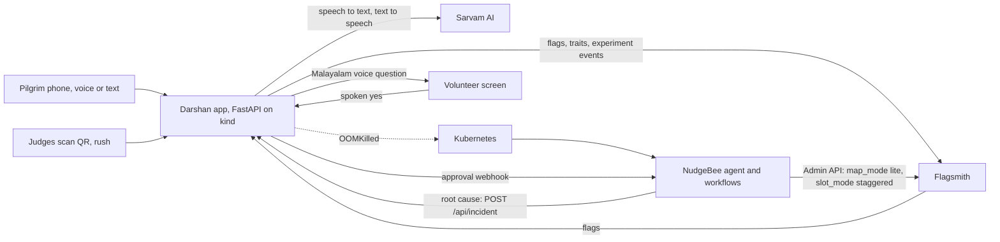

# Darshan Rush

**What:** a prototype that lets a pilgrim book a darshan slot by speaking in Malayalam, Tamil, Telugu, Kannada, Hindi or English, and keeps working when a whole crowd arrives at once.
**Who:** pilgrims at any crowded shrine (Sabarimala is the worked example), the volunteers at the spot counter who book for walk-ins without a phone, and the volunteer on duty who approves fixes by voice.
**How:** when a rush overloads the booking service, NudgeBee finds the cause, the app asks the volunteer by voice in Malayalam, and the volunteer's spoken yes flips Flagsmith flags so the service recovers.

Demo video: TODO add link

## Architecture



Pages: `/` pilgrim, `/static/judge.html` QR and rush button, `/static/graph.html` recovery chart, volunteer screen as served by the app.

## Sponsors

| Sponsor | What it does here | Where in the code | Our feedback |
|---|---|---|---|
| Flagsmith | Flags `map_mode` (full or lite) and `slot_mode` (open or staggered), flipped after approval. A/B test `voice_directions` (voice vs map directions, metric `reached_gate`). Traits `language` and age 65+ pick the voice-first experience. | `app/flags.py`, `app/static/app.js` (reads flags, records `reached_gate`), `nudgebee/*.yaml` (HTTP task that flips flags) | TODO fill in after the build |
| NudgeBee | Sees the OOMKilled booking pod, runs the root cause analysis, and runs an approval-gated workflow whose HTTP task flips the flags. | `nudgebee/`, `scripts/nudgebee_agent.sh`, `k8s/` | TODO fill in |
| Sarvam AI | Speech to text for the pilgrim and the volunteer's yes or no, text to speech for slot and queue readback and the volunteer question. | `app/sarvam.py`, `app/directions.py`, `app/volunteer.py` | TODO fill in |

## Setup (ten commands or fewer)

```bash
brew install kind kubectl helm cloudflared        # 1 (and start Docker or colima)
cp .env.example .env                              # 2 then fill the values below
python3 -m venv .venv && .venv/bin/pip install -r app/requirements.txt   # 3
scripts/cluster_up.sh                             # 4
scripts/build_load.sh && scripts/secrets.sh       # 5
scripts/deploy.sh                                 # 6  app at http://localhost:8088
scripts/tunnel.sh                                 # 7  prints the public URL, put it in PUBLIC_URL
scripts/nudgebee_agent.sh <agent-key>             # 8  then create the workflows per nudgebee/README.md
open http://localhost:8088/static/judge.html      # 9  QR and "Cause the rush"
open http://localhost:8088/static/graph.html      # 10 recovery chart
```

| Variable | Purpose |
|---|---|
| `SARVAM_API_KEY` | Sarvam speech and translation. Without credits the app shows "Voice unavailable (Sarvam credits). Type instead." |
| `FLAGSMITH_ENV_KEY` | Server-side environment key for reading flags and sending events |
| `FLAGSMITH_ADMIN_KEY` | Used by the NudgeBee workflow to flip flags |
| `NUDGEBEE_APPROVE_WEBHOOK` | Approval workflow URL called after the volunteer says yes |
| `NUDGEBEE_CRASH_WEBHOOK` | Optional. NudgeBee crash-report webhook. After a restart during a rush the app posts once: namespace, pod, reason, restart count, map mode |
| `INCIDENT_TOKEN` | Shared secret for `POST /api/incident` and the rush button |
| `HEAVY_MB` | Memory the full map mode allocates per request (what makes the pod run out of memory) |
| `STATE_FILE` | Where the volunteer state is kept |
| `PUBLIC_URL` | Address encoded in the judge QR code |

## What is simulated

- All crowd sizes, gate waiting times and slots are generated by the app (`SIMULATED` badge on every page). No real temple, booking system or camera feed is used.
- The "rush" is a load script against a local kind cluster. Before and after numbers come from that cluster, not from production.
- The booking pod is deliberately memory hungry in full map mode so that the failure is reproducible.

## How this differs from existing systems

Virtual-Q books a slot. The Swami chatbot answers questions. Darshan Rush does neither as its main job: it keeps working fairly, in your language, when everyone arrives at once. Slots turn staggered under load, the heavy map becomes a light list, and the people on duty approve the fix by voice instead of reading a dashboard.

## AI assistance disclosure

Built with Claude Code agents directed by the team. The agents wrote the code, scripts and this document; the team chose the idea, reviewed the results and ran the demo.

## Known limits

- Not affiliated with any temple and not for operational use.
- Voice depends on Sarvam credits. If they run out, typed input still works and the page says so.
- The slot readback falls back to the device voice if Sarvam audio is missing, and the page labels that.
- The map is a simple SVG diagram, not a real floor plan or tile map.
- Phones-connected count and the before/after table on the judge page are computed from `/api/metrics-lite` and need that endpoint to expose a phones count.
- Tested in a recent Chrome and Safari only.

## Team

TODO: names and roles.

## License

See `LICENSE`.
