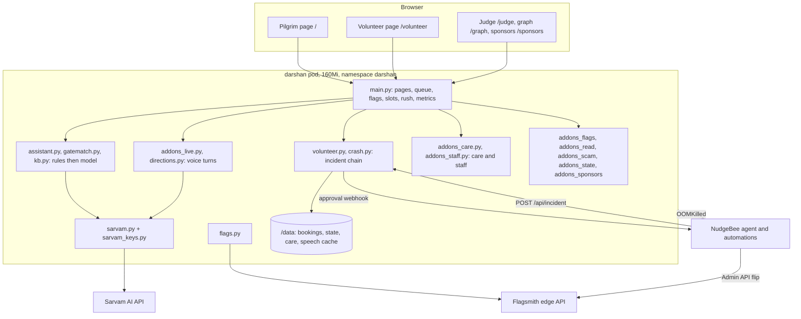

# Architecture

Darshan Rush is one FastAPI process (`app/main.py`, run as `uvicorn main:app`, no extra workers) in one Kubernetes pod, plus three sponsor services around it. This file describes the code as it is on 25 Nov 2026.

## Modules

| Area | Files | What they do |
|---|---|---|
| Core service | `app/main.py`, `app/config.py`, `app/queue_sim.py`, `app/slots.py` | Pages, `/api/queue`, `/api/slots/*`, rush start and stop, `/api/metrics-lite`, simulated crowd for five stops, slot windows (open or staggered), booking persistence in `/data/bookings.json` |
| Flags | `app/flags.py`, `app/addons_flags.py` | Flagsmith server SDK, 2 s cache, last-good value, default handler, traits, A/B counts; decisions, `ui_copy` and rollout endpoints |
| Speech | `app/sarvam.py`, `app/sarvam_keys.py` | One client for speech to text, translation, text to speech, chat; 8 s timeout; two-key failover on 402 and 429 |
| Assistant | `app/assistant.py`, `app/gatematch.py`, `app/kb.py`, `app/knowledge/*.json` | About 20 rule intents in six scripts first, then the Sarvam chat model with a facts block, with validated JSON output and a safe fallback; swappable venue knowledge pack |
| Voice turns | `app/addons_live.py`, `app/directions.py` | Live conversation state machine (slot, when, party size, confirm), tap-to-talk, directions |
| Incident chain | `app/volunteer.py`, `app/crash.py` | `/api/incident` receiver, Malayalam question, yes/no classifier, approval webhook, flag watcher, crash self-report |
| Care and staff | `app/addons_care.py`, `app/care_store.py`, `app/addons_staff.py` | Care requests with urgency routing to the nearest simulated volunteer; staff "Ask anything" |
| Extras | `app/addons_read.py`, `app/addons_scam.py` | Read a photo (Sarvam Vision), site check |
| State and proof | `app/addons_state.py`, `app/addons_sponsors.py` | One poll for every screen, assistant health guard, `/sponsors` page with recorded sponsor activity |
| Pages | `app/static/*.html`, `app/static/app.js`, `app/addons_ui/*` | Plain HTML and JS, Anek font, six scripts |
| Operations | `k8s/`, `scripts/`, `nudgebee/` | Deployment (1 replica, 160Mi, probes), kind cluster, tunnel, flip, rollout, rehearsal, NudgeBee workflow definitions |

## Request flow for one voice booking

1. The browser records speech and posts it to `/api/live/turn`.
2. `sarvam.stt` transcribes it with language detection. The reply language follows the detected language.
3. `assistant.answer` or the live booking state machine decides the intent from rules. Only unclear text goes to the chat model, whose output is checked against the facts.
4. `slots.book` takes a slot under a lock, in open or staggered mode, according to the `slot_mode` flag, and saves it to `/data`.
5. `sarvam.tts` speaks the slot (fixed lines come from a disk cache), and the page shows the slot card.

## What is where in state

| State | Held in | Survives container restart | Survives pod reschedule |
|---|---|---|---|
| Bookings | memory plus `/data/bookings.json` | yes | no (`emptyDir`) |
| Volunteer incident state | memory plus `STATE_FILE` | yes | no |
| Care requests and audio | `care.json`, `care_audio/` on `/data` | yes | no |
| Rush marker (crash detection) | `/data/rush_marker.json` | yes, that is its purpose | no |
| Sarvam call log | memory plus `sarvam_calls.jsonl` | yes | no |
| Pilgrim position, traits, A/B counts | memory only | no | no |
| Speech cache | `/data` plus seed audio shipped in the image | cache yes, seed always | seed only |

## Design rules we kept

- Rules decide, the model only words things: model output must reference real stop ids and numbers from the facts, or it is replaced.
- Flags are read at request time with a short cache, so a flip takes effect within about 2 s without a redeploy.
- A sponsor failure shows a clear message and never a fake result.
- Every simulated number carries a `SIMULATED` label.

## Known structural limits

Single replica, in-process locks, JSON files on an `emptyDir`, an in-pod load generator and a free quick tunnel. See [SCALE.md](SCALE.md).
